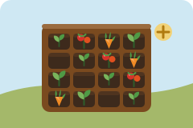
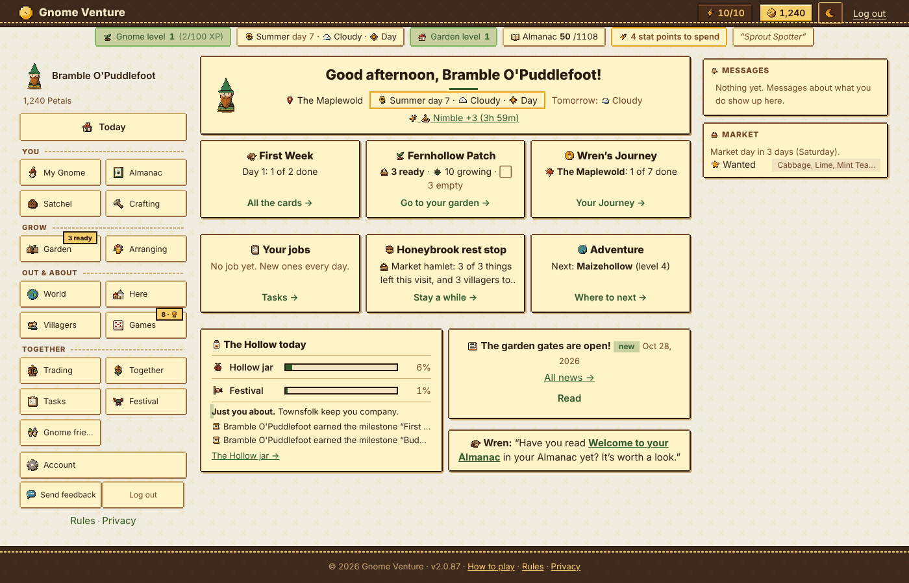
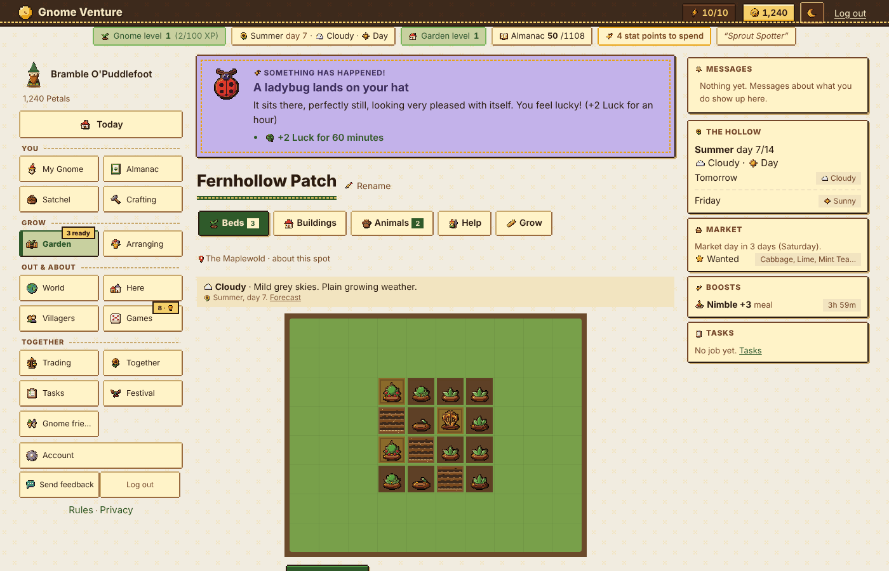
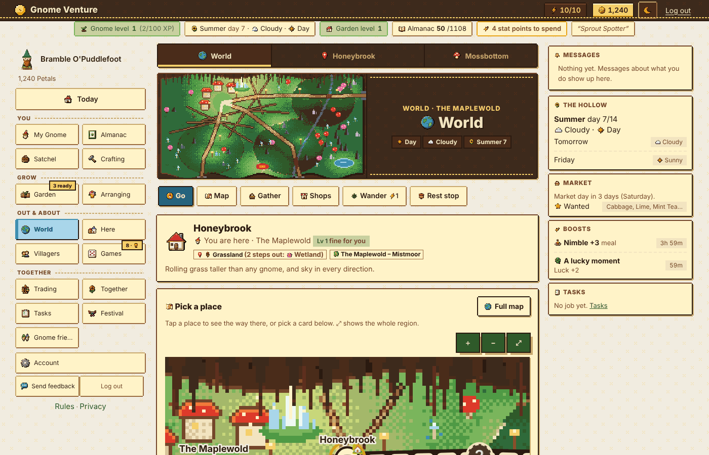
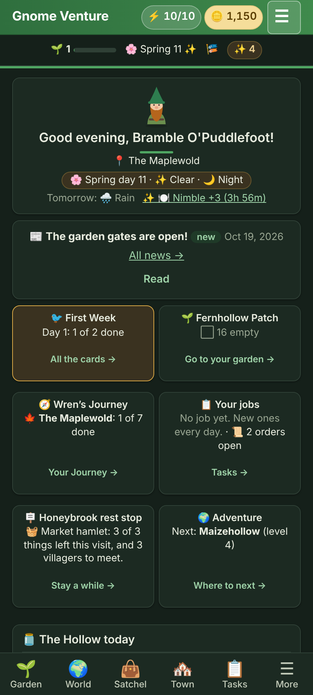
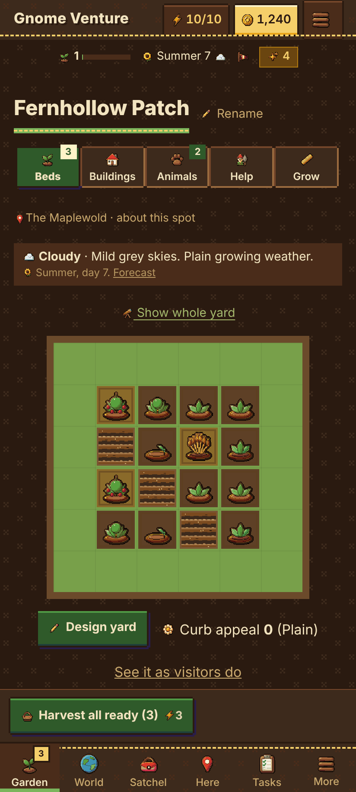
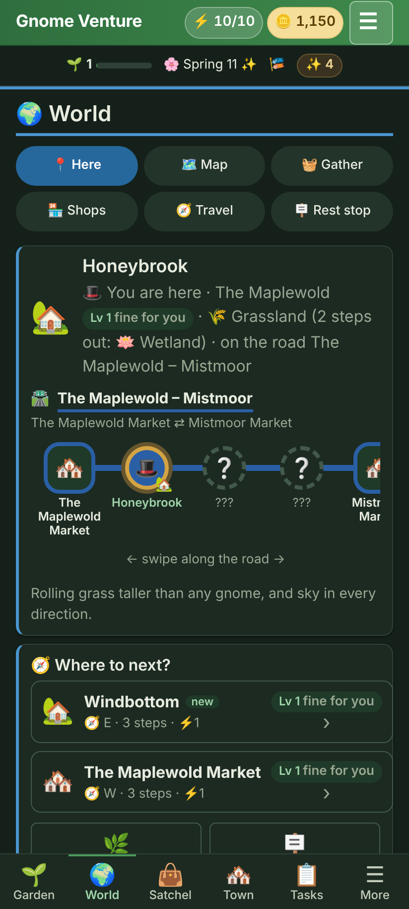

# Gnome Venture

Cosy garden browser game. Grow plants, tend beds, cook, trade, explore roads and regions, and hire help.
Live: gnomeventure.ca. No monetization.

Current version: see the top entry of [CHANGELOG.md](CHANGELOG.md). The single source of truth is `APP_VERSION` in `game/includes/bootstrap.php`; docs carry no hardcoded version (`bash tools/check_versions.sh` checks this).

## Screens

  
  
  
  
  
  
  

### Live build (test account)

Desktop (1400px):

  
  

  

Phone (412px, dark theme):

  
  
  

## Stack
- Plain PHP 8.1+ with PDO. No framework, no build step.
- MySQL on live host (CanSpace shared cPanel). SQLite for local tests.
- Vanilla JS (`game/assets/*.js`). One CSS file `game/assets/style.css` (tokens at top, dark theme via `:root[data-theme="dark"]`).

## Layout
- `game/` web root: pages, `includes/`, `admin/`, `assets/`, `uploads/`, `data/`.
- `game/includes/data/*.txt` shipped content. Importers add missing rows only.
- `game/includes/schema.php` tables, columns (`$c`), indexes (`$i`). Feature files add tables via `*_schema()`.
- `game/data/` denied to web by `.htaccess`. Runtime cache lives here.
- `tests/` test suites, walk script, release builder (`build_update.sh`).

## Key systems
- **Garden**: beds, tools, seeds, soil care, NPK, breeding (22 hybrids), animals (worm farm, ladybird lodge, frog pond, butterfly bush, snail jar, quail coop, silkworm shelf, tortoise run, goat, pigeon).
- **World**: 14 regions, 81 landmarks (havens, wonders, delves, lairs), region maps (`maps_myc.php`), road walks, exploring, rest stops with villagers.
- **Time**: Hollow time = America/Halifax. Days, weeks and months turn over at local midnight. Seasons are 14 days. Weather computed on view, no cron.
- **Economy**: Petals (currency), Trading Post, market day, townsfolk orders, Job Board, quests, callings (tiers at L5, L15, L28).
- **Games**: Worm Hunting, Seed Memory, Snail Race, Seed Spitting, Guess the Weight, Mushroom Sweeper, Lost Letters, Pest Patrol, Harvest Fair, Village Show, Pumpkin Carving, gathering practice.
- **Social**: gnome friends, guestbook stamps, gifts, watering for friends, Hollow Goals, Almanac (encyclopedia), passport.
- **Treks** (behind L15 gate and `trek_open` setting; admins only by default): NeoQuest-style party campaign. Chapter I "The Wilting Rows" and Chapter II-a/II-b "The Weeping Clay" are built. Story text is written in admin (Trek text).
- **Admin**: settings (labels "Feature: text"), users, retention, XP log, images, hybrids, treks, trek text, in-place updater.

## Run locally (tests)
1. Copy `game/` to a scratch dir. Remove `data/` and `config.php`. `mkdir -p data`.
2. `bash tests/walk.sh COPY PORT tests/router.php` (sets up test users).
3. `bash tests/<suite>.sh COPY PORT2 tests/router.php`. One suite per fresh copy.
Key suites: `walk.sh`, `treks.sh`, `security190.sh`, `market100.sh`, `games2.sh`, `explore.sh`, `landmarks.sh`.
Browser checks: Playwright + Chromium at 390/412px (phone) and 900/1400px (desktop). Use `bypassCSP: true` to inject test CSS.
MySQL cannot be tested locally. The live site is the check.

## Config and secrets
- `game/config.php` holds DB and SMTP details. Never committed (see `.gitignore`).
- Copy from the example/installer on a new host. Keep backups out of git.

## Release process
1. Bump `APP_VERSION` in `game/includes/bootstrap.php` only (the installer reads it from there). Versions stay numeric. Add a matching top entry in `CHANGELOG.md`, then run `bash tools/check_versions.sh`.
2. Add player news in `game/includes/update_news.php` (newest first; skip for tiny fixes; do not announce hidden features).
3. Lint: `for f in game/*.php game/includes/*.php game/admin/*.php; do php -l $f; done`.
4. Commit. Then from the folder holding `game/` and `tests/`: `bash tests/build_update.sh <new> 1.4.1 <ABSOLUTE outdir>`. Produces manifest, slim update zip, full zip, source zip.
5. Upload the slim zip via Admin → Update (or FTP). Full zip has no `install.php`.
Updater keeps DB dumps and program zips, never touches `config.php`, `install.php`, `data/`, `uploads/`.

## Upgrade steps
- Bootstrap runs when `db_version != APP_VERSION`, under `data/upgrade.lock`.
- Schema via `db_migrate`. Then `boot_step(name, fn)` steps (failures logged in `boot_failed_steps`). Plus `upgradeNNN.php` (flagged, idempotent).
- Changing a shipped default: guarded step, only if the row still holds the old value.
- Avoid MySQL 8 reserved words. No TEXT defaults.

## Conventions
- CSRF on every POST. `require_login` / `require_admin`. Ownership checks. `e()` escaping. Rate limits. Image upload checks.
- Race safety: conditional UPDATE/DELETE as claim + rowCount, or UNIQUE insert, or transaction with `UPDATE users SET id = id WHERE id = ?` then re-read.
- Mini-game Petal payouts wrap in `game_petals()`. Any new repeatable Petal source needs a daily cap or energy cost.
- UI: centre content, no sideways scroll, phone first (~412px), fold explanations, few words, solid buttons only for primary verbs.
- Popups: `<dialog>` with `gvOpenDlg` / `gvCloseDlg`. No `alert()` / `confirm()`.
- CSP `style-src 'self'`: no inline styles.
- Art fallback order: real art → flower art → placeholder SVG (`assets/img/ph/`) → emoji.

## Changes
Full history: [CHANGELOG.md](CHANGELOG.md).

## Open work
- Live/MySQL watch: hybrid CAST, mentor tables, InnoDB row locks, trek tables.
- Treks: Chapter II-b balance watch; Chapters III–VI not built.
- Road: region packs, road text admin editor, 146 villages share 9 descriptions.
- Ideas parked: growing villages, caravans, Hall of Fame, public region pages, postcards, admin 2FA, CAPTCHA.

## License

MIT, see [LICENSE](LICENSE). Covers the code and the art (pixel art made with Aseprite and AI tooling).
